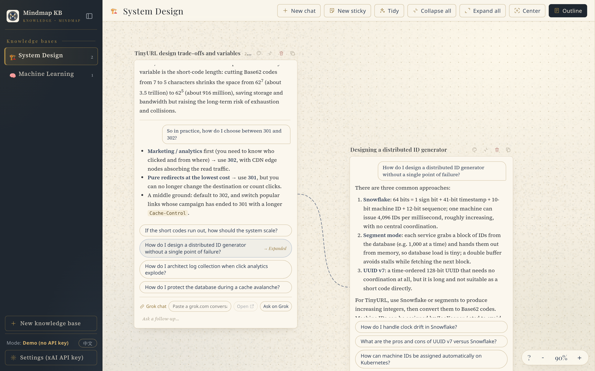

<p align="center"><a href="README.en.md"><b>English</b></a> | <a href="README.md">繁體中文</a></p>

<p align="center">
  
</p>

<h1 align="center">Grok Mindmap Knowledge Base</h1>
<p align="center"><b>心智圖知識庫</b></p>

<p align="center">
  Turn your Q&amp;A with Grok into mind-map cards you can branch, link, and collapse, building up a knowledge base of your own.
</p>

<p align="center">
  <a href="https://ansgarlin.github.io/grok-mindmap/"><b>🔗 Live demo</b></a> ·
  <a href="#quick-start">Quick start</a> ·
  <a href="#usage">Usage</a> ·
  <a href="LICENSE">MIT License</a>
</p>

> The app's interface is in Traditional Chinese. UI labels below are given in English, with the original label in parentheses, e.g. Tidy (`整理`).



## Features

- **Conversation cards**: each card is a multi-turn conversation, and follow-up questions continue in the same card. Grok also suggests follow-up questions; clicking one lets you choose Ask here (`在這裡提問`) or Ask in a new branch (`在新分支中提問`).
- **Blank sticky notes**: cards that never call Grok — type or paste your own content. Basic formatting (bold, lists, tables, links) is kept, images can be pasted directly, and plain text supports Markdown.
- **Conversation → sticky note**: right-click a conversation card and choose Convert to sticky (`轉成貼紙`) to turn its Q&A (diagrams included) into freely editable content. The original conversation is preserved, so you can later Convert back to conversation (`轉回對話`). If the sticky was edited, you can choose Copy the sticky, then convert back (`複製一份貼紙再轉回`): your edits stay on a new sticky placed next to it and linked to it. Or convert back directly and discard the edits. Any sticky can also be duplicated via right-click → Duplicate sticky (`複製貼紙`).
- **Link Grok conversations**: paste a grok.com conversation URL into any conversation card to open it in one click, or start a new grok.com conversation from the card's current question.
- **Branches and links**: the ＋ at the midpoint of each card edge opens a new branch on that side when clicked, or creates a link when dragged onto another card. Arrows are smooth curves that route around cards; you can recolor them, drag their endpoints to re-attach them, or remove them.
- **Collapse to TL;DR**: the first time a conversation card is collapsed, Grok writes a one-sentence summary (it can be regenerated, and is marked Outdated (`已過期`) after new turns are added). A sticky's TL;DR defaults to its first line and can be customized.
- **Groups**: marquee-select or Shift+click several cards, then right-click to create a group. Groups have a dashed frame and a bookmark tab, and can be dragged, recolored, and renamed.
- **Automatic layout**: Tidy (`整理`) packs cards into a compact, roughly square layout and re-routes the arrows. When a card grows or is added, nearby cards are pushed out of the way, and they spring back when it shrinks.
- **Outline sidebar**: compiles the whole knowledge base (or a single cluster) into one article, which Grok can rewrite into study notes. The rewrite prompt can be customized globally or per knowledge base.
- **Visual aids**: Mermaid diagrams and tables in answers are rendered inline; suggested illustrations and videos are generated by xAI only when you click them.
- **Multiple knowledge bases**: switch between knowledge bases in the left sidebar; each keeps its own viewport, selection, and outline state.
- **Undo / redo**: card position, size, links, groups, colors, and more can be undone.
- **Chinese and English UI**: switch between Traditional Chinese and English live from Settings or the language button at the bottom of the sidebar; the default follows your browser language. English mode has English default prompts, sample data and a Source Serif 4 body font, and answers come back in English. Custom prompts are never overwritten.
- **Demo mode**: works without an API key, using sample answers instead.

## Quick start

### Option 1: use the hosted version

Open <https://ansgarlin.github.io/grok-mindmap/>.

### Option 2: run it locally

```bash
git clone https://github.com/AnsgarLin/grok-mindmap.git
cd grok-mindmap
open index.html        # Windows: start index.html; Linux: xdg-open index.html
```

The project is plain static files — nothing to install or build. If your browser restricts loading local files, serve the folder with any static server, e.g. `python3 -m http.server 8765`, and open <http://localhost:8765/>.

### Set up your xAI API key

1. Sign in to the [xAI Console](https://console.x.ai/) and create an API key.
2. In the app, click Settings (`設定`) at the bottom left, paste the key, and save.
3. When the mode at the bottom left shows `Grok API`, the key is active; without a key the app runs in demo mode.

## Usage

| Action | Result |
|---|---|
| Drag empty space / two-finger scroll / Space + drag / middle-mouse drag | Pan the canvas |
| Mouse wheel / trackpad pinch | Zoom |
| Double-click | Zoom in around the cursor |
| Double right-click, or Alt/Option + double-click | Zoom out around the cursor |
| `Ctrl` `+` / `Ctrl` `−` / `Ctrl` `0` | Zoom in / zoom out / 100% |
| Right-click empty space | New conversation (`新對話`), New sticky (`新貼紙`), Tidy (`整理`), Collapse / Expand all (`全部收合`／`全部展開`), Center (`置中`), Outline (`大綱`), zoom, Marquee select (`框選卡片`) |
| Right-click a card | New branch conversation / sticky (`新增分支對話`／`新增分支貼紙`), Link to… (`連結到…`), Convert to sticky / Convert back to conversation (`轉成貼紙`／`轉回對話`), Duplicate sticky (`複製貼紙`), collapse, TL;DR, Copy Markdown (`複製 Markdown`), Reset size (`重設大小`), color, Delete (`刪除`) |
| ＋ on a card edge | Click: open a new branch on that side; drag: link to another card |
| Drag a card's title bar | Move the card |
| Drag a card's right edge / bottom edge / bottom-right corner | Resize the card |
| Double-click a card title | Rename |
| Hover a conversation card and start typing | Ask a follow-up in that card (the wheel scrolls that card's conversation) |
| Click a sticky's content | Edit the sticky; click outside the card or press `Esc` to finish |
| Conversation / Blank sticky switch (`對話匡｜空白貼紙`) in a new draft's title bar | Choose the type of the new card |
| `Shift` + drag empty space / `Shift` + click a card | Marquee-select / add cards to the selection; right-click to create a group or act on them in bulk |
| Drag a group's top edge (bookmark tab) | Move the whole group |
| Select an arrow and press `Delete`, or right-click an arrow | Remove the link, change the arrow color |
| Drag an arrow endpoint | Re-attach it to another side or card |
| `Ctrl`/`Cmd` + `Z`; `Ctrl`/`Cmd` + `Shift` + `Z` or `Ctrl` + `Y` | Undo; redo |
| `Esc` | Clear the selection, close menus, cancel link mode |

The `?` button at the bottom right of the canvas also lists these controls.

## Privacy

- Your data stays in your own browser: cards and settings in `localStorage`, images in `IndexedDB`. There is no backend server, and nothing is uploaded anywhere by this project.
- The xAI API key is also stored only in the browser's `localStorage` and is used only to call `api.x.ai` directly from your browser.
- Data is not synced across computers or browsers; clearing site data also deletes your cards.
- When the xAI API is called, your questions and conversation content are sent to xAI and billed to your xAI account.

## Tech stack

- **Pure front end**: a single `index.html` with vanilla JavaScript, HTML, CSS, and SVG — no framework, no build step.
- **xAI API** (OpenAI-compatible): chat `/v1/chat/completions`, images `/v1/images/generations`, video `/v1/videos/generations`.
- **Mermaid 11**: vendored in `vendor/` and loaded locally, with a custom theme.
- **Fonts**: Playfair Display, Noto Serif TC (subset) and Source Serif 4 (Latin subset, English UI body text), all under the SIL Open Font License 1.1; license texts are in `vendor/fonts/`.

## Project structure

```
.
├── index.html          # the whole app (HTML + CSS + JS)
├── SPEC.md             # product spec and changelog
├── DESIGN-STYLE.md     # design style (French editorial) and design tokens
├── prompts/            # default answer and outline rewrite prompts (Chinese, plus .en.md English)
├── icons/              # app icons (option-8 is the one in use)
├── vendor/
│   ├── mermaid.min.js  # Mermaid 11
│   ├── fonts/          # Playfair Display, Noto Serif TC, Source Serif 4 subsets, licenses
│   └── textures/       # canvas texture
├── docs/               # README screenshots
├── README.md           # README (Traditional Chinese)
├── README.en.md        # README (English)
└── LICENSE
```

## Roadmap and known issues

- Data lives in a single browser; there is no cross-device sync or file import/export yet.
- grok.com has no public conversation-history API, so Grok conversations can only be linked by URL, not imported automatically.
- Switching the UI language does not translate existing cards or AI answers; it only changes the interface, the default prompts and the language of new content.
- Noto Serif TC ships only as a subset covering the UI text; other Chinese characters fall back to the system Song/Ming serif.
- Images inside stickies appear as “(image)” (“（圖片）” in the Chinese UI) in the outline article.
- Native blank stickies cannot be converted into conversations. Converting a converted sticky back restores the original conversation; edits made on the sticky are not merged back into it (you can keep them as a sticky copy).

## License

This project is licensed under the [MIT License](LICENSE). The fonts are licensed under their respective SIL Open Font License 1.1; Mermaid is licensed under its MIT License.
