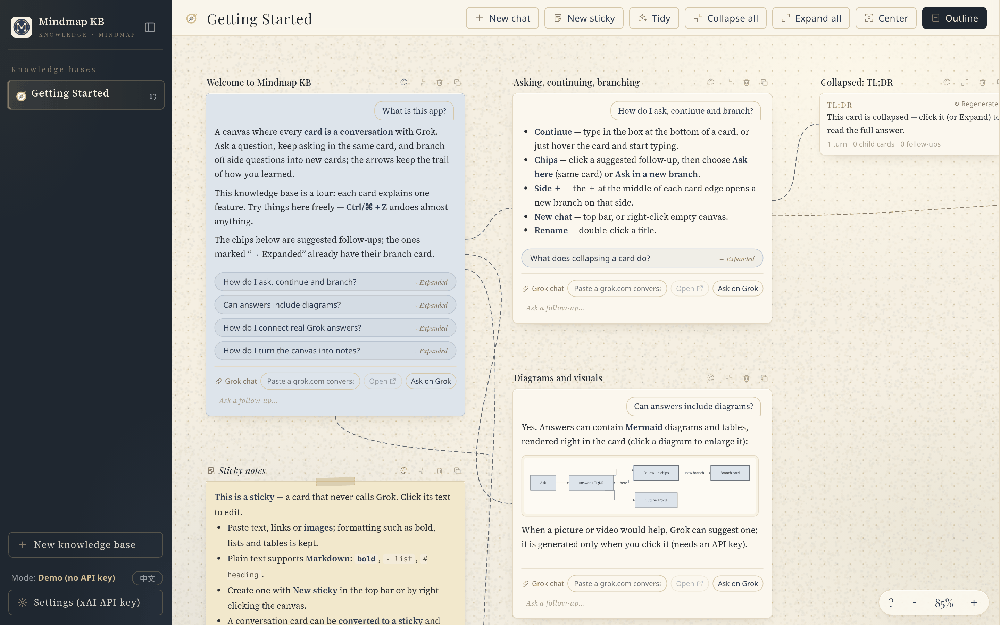

<p align="center">
  
</p>

<h1 align="center">心智圖知識庫</h1>
<p align="center"><b>Grok Mindmap Knowledge Base</b></p>

<p align="center">
  把和 Grok 的問答整理成可分支、可連結、可收合的心智圖卡片，累積成自己的知識庫。
</p>

<p align="center">
  <a href="https://ansgarlin.github.io/grok-mindmap/"><b>🔗 線上試用</b></a> ·
  <a href="#快速開始">快速開始</a> ·
  <a href="#操作方式">操作方式</a> ·
  <a href="LICENSE">MIT License</a>
</p>



## 功能

- **對話卡片**：每張卡片是一段多輪對話，後續問題在同一張卡片裡繼續問；Grok 會附上建議追問，點選時可選擇「在這裡提問」或「在新分支中提問」。
- **空白貼紙**：不呼叫 Grok 的卡片，自己輸入或貼上內容；保留粗體、清單、表格、連結等基本格式，也能直接貼上圖片，純文字支援 Markdown。
- **對話轉貼紙**：對話卡片可以右鍵「轉成貼紙」，把問答（含圖解）變成可自由編輯的內容；原本的對話會保留，之後可以「轉回對話」（貼紙上的修改不會帶回對話，轉回前會先確認）。
- **連結 Grok 對話**：每張對話卡片可以貼上 grok.com 的對話網址，一鍵開啟；也能以目前的問題直接在 grok.com 開新對話。
- **分支與連結**：卡片四邊中點的 ＋，點擊在該側開新分支，拖曳到其他卡片建立連結；箭頭是避開卡片的平滑曲線，可改顏色、拖曳端點重新接上、取消連結。
- **收合為 TL;DR**：對話卡片第一次收合時由 Grok 產生一句話摘要（可重新產生，新增對話後標示「已過期」）；貼紙的 TL;DR 預設取第一行，也可自訂。
- **群組**：框選或 Shift＋點選多張卡片後，右鍵建立群組；群組有虛線框和書籤標籤，可拖曳、改色、改名。
- **自動排版**：「整理」把卡片排得緊湊、接近正方形，並重新繞線；卡片長大或新增時自動推開鄰近卡片，縮回時彈回。
- **大綱側欄**：把整個知識庫（或單一族群）彙整成一篇文章，也可以用 Grok 改寫成學習筆記；改寫提示詞可全域或依知識庫自訂。
- **圖解輔助**：回答中的 Mermaid 圖解與表格直接顯示；建議插圖／影片只有在點擊後才呼叫 xAI 生成。
- **多個知識庫**：左側欄切換知識庫，各自保存畫面位置、選取與大綱狀態。
- **復原／重做**：卡片位置、大小、連結、群組、顏色等操作都可以復原。
- **示範模式**：沒有填 API Key 也能操作，回答會以示範內容代替。

## 快速開始

### 方式一：直接使用線上版

打開 <https://ansgarlin.github.io/grok-mindmap/> 即可使用。

### 方式二：在本機開啟

```bash
git clone https://github.com/AnsgarLin/grok-mindmap.git
cd grok-mindmap
open index.html        # Windows：start index.html；Linux：xdg-open index.html
```

本專案是純靜態檔案，不需要安裝套件或建置。若瀏覽器限制本機檔案載入，可以改用任一靜態伺服器，例如 `python3 -m http.server 8765`，再開啟 <http://localhost:8765/>。

### 設定 xAI API Key

1. 到 [xAI Console](https://console.x.ai/) 登入並建立 API Key。
2. 在 App 左下角點「設定」，貼上 API Key 後儲存。
3. 左下角模式顯示「Grok API」即表示已啟用；沒有 Key 時為示範模式。

## 操作方式

| 操作 | 效果 |
|---|---|
| 拖曳空白處／雙指滑動／空白鍵＋拖曳／滑鼠中鍵拖曳 | 平移畫布 |
| 滾輪／觸控板捏合 | 縮放 |
| 雙擊 | 以游標為中心放大 |
| 右鍵雙擊，或 Alt/Option＋雙擊 | 以游標為中心縮小 |
| `Ctrl` `+`／`Ctrl` `−`／`Ctrl` `0` | 放大／縮小／100% |
| 右鍵空白處 | 新對話、新貼紙、整理、全部收合／展開、置中、大綱、縮放、框選 |
| 右鍵卡片 | 新增分支對話／貼紙、連結到…、轉成貼紙／轉回對話、收合、TL;DR、複製 Markdown、重設大小、顏色、刪除 |
| 卡片四邊的 ＋ | 點擊：在該側開新分支；拖曳：連到另一張卡片 |
| 拖曳卡片標題列 | 移動卡片 |
| 拖曳卡片右緣／下緣／右下角 | 調整卡片大小 |
| 雙擊卡片標題 | 重新命名 |
| 游標停在對話卡片上直接打字 | 在該卡片繼續提問（滾輪捲動該卡片的對話） |
| 點擊貼紙內容 | 編輯貼紙；點卡片外或 `Esc` 完成 |
| 新對話草稿標題列「對話匡｜空白貼紙」 | 切換新卡片的類型 |
| `Shift`＋拖曳空白處／`Shift`＋點卡片 | 框選／加選卡片，再按右鍵可建立群組或批次操作 |
| 拖曳群組上緣（書籤標籤） | 移動整個群組 |
| 點選箭頭後按 `Delete`，或右鍵箭頭 | 取消連結、改箭頭顏色 |
| 拖曳箭頭端點 | 重新指定連接的邊或卡片 |
| `Ctrl`/`Cmd`＋`Z`；`Ctrl`/`Cmd`＋`Shift`＋`Z` 或 `Ctrl`＋`Y` | 復原；重做 |
| `Esc` | 取消選取、關閉選單、取消連結模式 |

畫面右下角的 `?` 也有操作說明。

## 隱私

- 資料只存在你自己的瀏覽器：卡片與設定存在 `localStorage`，圖片存在 `IndexedDB`。沒有後端伺服器，也不會上傳到本專案的任何地方。
- xAI API Key 同樣只存在瀏覽器的 `localStorage`，只會用來從你的瀏覽器直接呼叫 `api.x.ai`。
- 換電腦或換瀏覽器時資料不會同步；清除網站資料會一併刪除卡片。
- 呼叫 xAI API 時，問題與對話內容會送到 xAI，並依你的 xAI 帳號計費。

## 技術

- **純前端**：單一檔案 `index.html`，原生 JavaScript、HTML、CSS 與 SVG，沒有框架、沒有建置步驟。
- **xAI API**（OpenAI 相容）：對話 `/v1/chat/completions`、圖片 `/v1/images/generations`、影片 `/v1/videos/generations`。
- **Mermaid 11**：放在 `vendor/` 本機載入，使用自訂主題。
- **字型**：Playfair Display 與 Noto Serif TC（子集），皆以 SIL Open Font License 1.1 授權，授權文字見 `vendor/fonts/`。

## 專案結構

```
.
├── index.html          # 整個 App（HTML + CSS + JS）
├── SPEC.md             # 產品規格與版本紀錄
├── DESIGN-STYLE.md     # 設計風格（法式編輯風）與設計變數
├── prompts/            # 預設回答提示詞、大綱改寫提示詞
├── icons/              # App 圖示（option-8 為目前使用）
├── vendor/
│   ├── mermaid.min.js  # Mermaid 11
│   ├── fonts/          # Playfair Display、Noto Serif TC 子集與授權
│   └── textures/       # 畫布紋理
├── docs/               # README 截圖
└── LICENSE
```

## 路線圖與已知問題

- 資料只存在單一瀏覽器，尚無跨裝置同步或匯入／匯出檔案功能。
- grok.com 沒有公開的對話紀錄 API，所以只能用網址連結 Grok 對話，無法自動匯入內容。
- Noto Serif TC 只內建介面用字的子集，其他中文字會改用系統的宋體／明體。
- 貼紙內的圖片在大綱文章中以「（圖片）」表示。
- 原生的空白貼紙無法轉成對話；由對話轉來的貼紙轉回時，會還原原本的對話，貼紙上的修改不會保留。

## 授權

本專案以 [MIT License](LICENSE) 授權。字型依各自的 SIL Open Font License 1.1 授權；Mermaid 依其 MIT License 授權。
