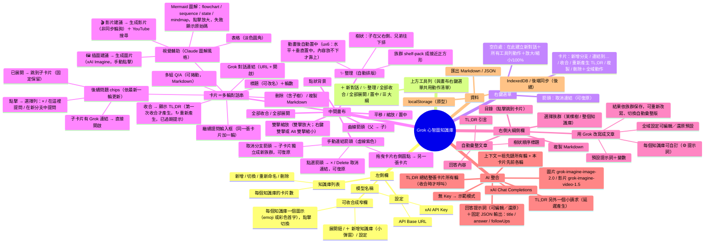

# Grok 心智圖知識庫 — 產品規格（v1.0）

> **文件規則**：README 有中文（`README.md`，預設）與英文（`README.en.md`）兩版，兩者開頭都有語言切換連結；每次功能變更都必須**同時**更新兩份 README（章節、功能清單、操作表、已知問題保持一致）與本規格。

> v1.0：**介面支援英文（i18n）**。
> - **語言**：繁體中文（`zh-TW`，預設）與英文（`en`）。設定最上方「介面語言」下拉選單，以及側欄底部的語言小按鈕（顯示另一種語言：中文模式顯示「English」、英文模式顯示「中文」）。偏好存在 `localStorage['grok-mindmap-lang']`；沒有存過時依 `navigator.language`：`zh*` → 繁中，其他 → 英文。切換**即時生效**、不重新載入、不影響畫布位置、選取、展開狀態、大綱與草稿；`<html lang>`（`zh-Hant-TW`／`en`）與頁面標題同步更新。
> - **字串表**：所有介面文字（按鈕、選單、對話框、提示、toast、瀏覽器 confirm／prompt、title／placeholder／aria-label、色票名 Rose／Sage／Slate Blue／Ochre／Wheat Gold、字標與副標、說明面板、提示詞變數說明）都有英文。原始碼仍以中文字串為鍵：`T(s, vars)` 先查英文字典，再比對帶數字／名稱的規則（如「刪除 3 張」→「Delete 3 cards」、單複數），最後把以「・」相接的片段逐段翻譯。英文模式下用一個 MutationObserver 翻譯介面文字節點與屬性，**跳過使用者／AI 內容**（回答、問題泡泡、chip、TL;DR、貼紙內容、大綱文章、知識庫名稱、群組名稱、Mermaid、媒體、輸入框、可編輯區）；切回中文時還原原文，中文模式下 observer 完全不運作。產生在跳過區內的字（貼紙提示、TL;DR 佔位、圖解載入／錯誤、媒體按鈕等）直接在產生處呼叫 `T()`。英文字標為「Mindmap KB」（完整名稱「Mindmap Knowledge Base」放在頁面標題，側欄寬度放不下）。
> - **提示詞**：回答提示詞、JSON 回覆格式、TL;DR、大綱改寫提示詞、寫作偏好都有英文預設（`prompts/*.en.md`），預設值依目前語言切換，回覆語言跟著介面語言。**自訂提示詞永不覆寫**：英文模式下若使用自訂回答提示詞，系統訊息後面加一句「Always reply in English.」；自訂大綱提示詞則加「Write the article in English.」。大綱提示詞變數另外接受英文別名 `{{kb}}`、`{{scope}}`、`{{today}}`、`{{count}}`、`{{style}}`。
> - **範例資料**：第一次開啟且語言為英文時，種子知識庫是英文版（System Design／Machine Learning，含英文 Mermaid 圖）；**已存在的資料一律不動**（切換語言不會翻譯或改寫卡片、標題、知識庫名稱）。新卡片的預設標題（New chat／New branch／New sticky）、群組預設名稱、副本標題、大綱與複製出來的 Markdown 標記（Follow-ups、Q、Grok chat、Learning summary…）依當下語言產生。示範模式的假回答也有英文版。
> - **字型**：英文模式內文襯線改用 **Source Serif 4**（Latin 子集，SIL OFL 1.1，`vendor/fonts/SourceSerif4-*.woff2`＋`OFL-SourceSerif4.txt`）；回答、問題泡泡、TL;DR 使用它；介面無襯線字以拉丁字型優先（避免彎引號 ’ 落到 CJK 字型而變成全形）。
> - **版面（英文）**：卡片內文字、chip、TL;DR、貼紙、大綱、toast、選單、群組標籤都加 `overflow-wrap: anywhere`，長單字與長網址會斷行；程式碼區塊改為橫向捲動；標題仍以省略號截斷。工具列按鈕不換行；工具列寬度（container query）不足 900px 時英文非主要按鈕只顯示圖示（tooltip 保留文字），中文在不足 640px 時才如此；英文時知識庫標題至少保留 96px。
> - **測試**：`test_i18n.py`（切換、持久化、navigator 預設、英文模式下所有選單／對話框／設定／說明／大綱／貼紙／群組／原生 confirm 的「無中日韓字元」掃描、卡片溢出檢查、1280／1000px 與大綱開啟時的工具列）。舊測試以 `MM_LANG`（預設 `zh-TW`）設定瀏覽器語系。

> v0.9.2：**轉回對話時可保留修改**。由對話轉來、且轉換後有修改的貼紙按「轉回對話」，改用設計風格的小對話框（取代瀏覽器 confirm），三個選項：「複製一份貼紙再轉回」（主要，預設聚焦）、「直接轉回（捨棄修改）」、「取消」（Esc／點背景也是取消）。沒修改過就直接轉回、不跳對話框。
> - **副本**是原生貼紙（沒有 `origConversation`，所以永遠不會出現「轉回對話」），帶走修改後的內容、自訂 TL;DR、顏色、大小（w/h）與收合狀態，標題加「（貼紙副本）」；用分支的相鄰擺放規則放在原卡片右側並推開鄰居，加入原卡片的群組。
> - **決定：副本會以一條手動連結（原卡片 → 副本）接起來**，讓來源一眼可見；不設成子卡片，以免改變原本的樹狀結構與大綱順序。連結可像其他連結一樣刪除或改色。
> - 「複製＋轉回」是**一個復原步驟**（一次 Ctrl+Z 同時移除副本與連結、把卡片變回貼紙）。
> - 任何貼紙右鍵都有「複製貼紙」：同樣產生原生貼紙副本（標題加「（副本）」），放在右側，加入同一群組，不加連結。

> v0.9.1：**對話匡 ⇄ 貼紙轉換**。對話卡片右鍵「轉成貼紙」（草稿或回答中的卡片不可用）：問答以 Markdown 寫入貼紙內容（`**Q：** 問題` ＋ 回答，輪與輪之間以 `---` 分隔；Mermaid 圖解、```image／```video 區塊照原樣保留並照常渲染），原本的 TL;DR 成為貼紙的自訂 TL;DR。原始對話資料（turns、followUps、grokUrl、tldr、tldrTurns、tldrAt、status、askDraft）**原封不動**存在 `card.origConversation`，另存轉換當下的 Markdown（`origConversation.md`）用來判斷是否有編輯。
> - 只有帶 `origConversation` 的貼紙會出現右鍵「轉回對話」；原生貼紙永遠不會有。
> - **轉回時的編輯處理（決定）**：一律還原**原本的對話**，貼紙上的編輯**不會**合併回對話（Markdown 無法可靠地拆回各輪問答，合併會讓對話紀錄失真）。若貼紙內容或 TL;DR 在轉換後被修改過，先跳確認「貼紙上做的修改會被捨棄（之後可用 Ctrl＋Z 復原）」；取消則保持貼紙。沒有修改就直接轉回，不跳確認。
> - 兩個方向都只換內容：位置、大小（w/h）、顏色、父子關係、連結、群組、推開狀態都不變。兩個方向都可以復原／重做：快照與目前卡片類型不同時，復原會連同內容欄位一起還原（一般操作仍不會動到對話內容）。轉換狀態隨知識庫保存。

> v0.9：**空白貼紙（sticky note）卡片類型**。卡片分成兩種：「對話匡」（原本的 Grok 問答卡）與「空白貼紙」（`card.kind = 'note'`，內容由使用者自己輸入或貼上，**不呼叫 Grok**）。
> - **建立**：上方工具列「新貼紙」、畫布右鍵「在此建立新貼紙」、卡片右鍵「新增分支貼紙」。所有新對話草稿（工具列、右鍵、卡片四邊 ＋、右鍵分支）的標題列都有「對話匡｜空白貼紙」切換，按「空白貼紙」即把草稿轉成貼紙（已輸入的文字保留為貼紙內容）。
> - **編輯**：點貼紙內容進入編輯（contenteditable），點卡片外或 Esc 完成。貼上 HTML 時保留基本格式（粗體、斜體、底線、標題、清單、引言、程式碼、表格、連結），其他屬性、樣式與 script 全部移除；`javascript:` 連結移除，http(s)/mailto 連結另開分頁。貼上圖片存到 IndexedDB（`note_<hash>`），卡片只存 `` 參照。沒有任何格式、但看起來像 Markdown 的純文字存成 `noteMd`，非編輯狀態用 Markdown 渲染（含 Mermaid）；其他存成清理過的 `noteHtml`。
> - **沒有**提問列、建議追問、Grok 網址列與 TL;DR API 呼叫。其他行為與對話匡相同：顏色、調整大小、收合、四邊 ＋／連結／箭頭、群組、推開邊界、復原／重做（卡片類型也在復原範圍內）、整理、各知識庫獨立儲存。
> - **收合**：TL;DR＝使用者自訂（收合後按「✎ 自訂」或右鍵「自訂 TL;DR」，留空＝回到預設），預設取內容第一行／第一個標題。
> - **大綱**：貼紙內容轉成 Markdown 出現在大綱文章中（圖片顯示為「（圖片）」）；「用 Grok 改寫」時以 `<note>` 區塊送出。複製 Markdown 也包含貼紙內容。
> - 外觀：同一組 5 色；象牙底帶淡橫線的紙張、頂端金色紙膠帶、右下折角、標題斜體並帶貼紙小圖示。

> v0.8：**視覺改版——法式編輯風**（見〈設計風格〉一節與 DESIGN-STYLE.md）：深色側欄＋金色細線＋襯線字標、奶油色點描畫布、象牙卡片、細線 SVG 圖示組取代 emoji、柔和的 5 色、墨藍虛線箭頭、雜誌排版的大綱、新的 Mermaid 主題，回答提示詞也加入了新的圖解／插圖風格描述；新 App 圖示（option-8）。只改外觀，功能不變。

> v0.7.4（使用者變更）：**右鍵雙擊＝縮小**——在畫布或卡片本體上 350ms 內、相距 ≤12px 連按兩次右鍵，以游標為中心縮小 ÷1.6（150ms 動畫，游標下的點不漂移）；例外同左鍵雙擊（輸入框、文字區、按鈕、標題等）。單次右鍵仍**立即**開啟選單（110ms 淡入）；第二下右鍵會把剛開的選單關掉並縮小，不會再開一次選單。Alt/Option＋雙擊縮小照舊。兩下之間若有左鍵或按鍵（例如 Esc），就不算雙擊（右鍵 → Esc → 右鍵＝再開選單）。

> v0.7.4（使用者變更）：群組成員的新分支（chip／＋／右鍵選單）**直接加入同一群組**、放在框內緊貼父卡片；框長大時整體推開框外卡片，框再縮小（分支刪除／草稿移除／收合）時被推開的卡片彈回。

> v0.7.4（ux6 修正）：**多欄子卡片的扇形路由**——父卡片的（未手動指定邊的）子卡片在其右方排成 ≥2 欄時，整個家族一起排線：兩欄之間的每條曲線都用同一個 S 形（水平切線、控制點在走道一半），來源與目標上下順序一致所以永不交叉；往後面欄位的箭頭直線穿過前面欄位的列間空隙，同一空隙的箭頭**共用同一條主幹**（重疊成一條線），並**分層分岔**（第三欄的箭頭在第二道走道才分出，不從父卡片分出）。父卡片右邊放上方的目的地，其餘從**下緣**以巢狀的四分之一彎離開，越深的越靠**左下**，所以走在其他線的左方／下方。任何一條碰到其他卡片就整個家族退回一般路由。14 個子卡片（三欄）：箭頭交叉 12 → 0（共用主幹不算交叉），父卡片上的起點 14 → 10；10 個子卡片 tidy 後交叉 10 → 0。**端點圓點只在滑過、選取或拖曳中的箭頭顯示**。**置中**在任何視窗形狀都水平＋垂直置中（內容比畫面高時才靠上）。

> v0.7.3（ux5 修正）：第二欄子卡片箭頭走欄間走道（成束、優先於擠過去的單弧），多欄需好 25% 才採用；側邊端點依實際離開方向排序、推開後重排；斜對角的卡片依錨點連線方向選邊（不再出現下→上的 S 迴圈）；端點圓點就在箭頭上；成束大繞路捨棄；整理時較舊的樹靠左上、長寬比以可見畫布為目標；放下推開的卡片保持在畫面內。
>
> v0.7.3（ux4 修正）：多選部分壓到群組框時整體推出；成束箭頭停在標題列上方、依目標列排序且依實際空隙走；＋ 與端點圓點最多 18px、縮小時隨卡片變小，上方 ＋ 剛好貼在標題上；窄卡片的 Grok 列改為圖示；「整理」改為輪廓式樹排版＋多欄子卡片＋2D 重力打包（間距只來自邊界）。
>
> v0.7.3（ux3 修正）：跨欄分支成束繞過第一欄、不再繞出視野；同一邊箭頭最小間距 18px、放不下就溢到相鄰邊；部分壓到群組框的卡片被推出框外；放下時依相對位置決定推開方向；提問列位置縮為 44px 並顯示「繼續提問…」提示；縮小檢視時上方 ＋ 抬到標題列上方；提示訊息移到畫布左下角並在游標靠近時淡化。
>
> v0.7.3：**箭頭一律是單一平滑弧線**（避開卡片時只換邊／調整或鼓起控制點，最多多一個平滑彎，沒有折線繞路）；**拖曳箭頭端點可改邊或改接到別張卡片**（分支只能改邊，可復原）；**整理時重選所有錨點**；**群組框是推開與放置的障礙物**（群組成員開分支時新卡片放在框外 80px）；**Shift＋拖曳改為多選**（Shift＋點卡片切換、點空白或 Esc 清除；右鍵選取區可建立群組、改顏色、收合／展開、移出群組、刪除，拖曳標題列一起移動，皆可復原；選單「框選建立群組」改名「框選卡片」）；**邊界（margin box）模型**統一所有間距（4.I）；**UX2 修正**：放下時推開＋加入／退出群組、草稿與提問文字存在卡片上、同邊多條箭頭分散、提問列疊在卡片內、＋與端點縮小時保持大小、提示訊息堆疊、重新載入後仍可復原、同側滿 4 張換欄、離開頁面時立即存檔；**UX 修正**：推開間距 80px、同側分支依序排列、收合寬度上限 440、整理時子群組排在父卡片之後、Ctrl／⌘＋Z 復原與重做、被推開卡片閃爍＋「已推開 N 張・復原」、全部展開後置中、空白草稿自動移除、新草稿擁有鍵盤、縮小時把手保持可點、成長時優先往下／右推；**卡片的提問列預設隱藏**，游標在卡片上或聚焦時 120ms 淡入，疊在卡片內底端預留的位置（不會觸發推開、不會蓋到鄰居）。**連接的新卡片緊貼在該側**（間距 80px），擋到的卡片／群組被**推開**（沿建立方向連鎖推，群組整組移動，150ms 動畫後重算箭頭）。**卡片可調整大小**（右緣、下緣、右下角；寬 280–900、內容高 120–1200 或自動；存在卡片上；右鍵「重設大小」）。卡片**變大時自動推開**重疊的鄰居（展開、新回答、調整大小、全部展開），縮回時被推開的卡片**彈回原位**（使用者沒移動過的才會）；調整大小時即時推開／彈回。**全部收合後自動整理**。

> v0.7.2：**分支箭頭與手動連結統一**：同一種樣式（紫色虛線 1.6px、同一箭頭、側邊中點錨點、雙向時錯開 14px）與同樣功能（選取、×／Delete 刪除、右鍵橫向色票＋取消連結、顏色保存、復原）；分支顏色存在子卡片的 `edgeColor`，取消分支仍是把子卡片分離成獨立族群（可復原），樹狀語意（對話鏈、整理、大綱）不變。**每個知識庫各自保存 UI 狀態**（視角平移／縮放、大綱開關＋範圍＋自動／Grok 版本、選取的卡片／箭頭、卡片對話串捲動位置），切換與重新載入時還原；左側欄維持全域。拖曳大綱邊緣時畫布**即時等比縮放**（變寬縮小、變窄放大、中心不動，取代放開後重新置中）；左側欄自動收合／恢復時不跳動；按鈕開關大綱也套用同樣的縮放（放開、跨過 45%／50%、左側欄自動收合／恢復都**不再重新置中**）。**滑鼠移到卡片上即啟用**（選取、第一下滾輪就捲動對話、直接打字進該卡片的輸入框）。**群組整條頂端（約 52px）都可拖曳**移動群組。**箭頭自動繞過其他卡片與群組標籤**（正交 A* 圓角路徑、快取、拖曳時暫用曲線）；新分支卡片優先放在路徑暢通的位置；「✨ 整理」後重算全部路徑，排版也偏好交叉較少的配置。

> v0.7.1：**拖曳空白處恢復為平移**；框選群組改為 **Shift＋拖曳**（按住 Shift 時空白處顯示十字游標），或畫布右鍵「框選建立群組」進入一次性框選模式（Esc 取消）。**手動連結可改顏色**（右鍵連結或選取時 × 下方的色票列：預設紫＋5 色，線與箭頭同為鮮色，存在連結上）。**卡片四邊中點改為 ＋ 按鈕**（hover 才顯示）：點擊＝在該側空位開新分支對話（真正的分支，箭頭從該側中點連到子卡片對側，記錄 `parentSide`，輸入框自動聚焦）；拖曳（≥4px）＝建立連結。**大綱寬度**：最小＝預設 420px、最大＝視窗 50%（拉到最大即自動收合左側欄並重新置中）；拖窄時（放開、或回到 <45% 恢復左側欄時）重新置中；每次開啟都回到預設寬度（不記住）。

> v0.7：**5 色調色盤**（紅／綠／藍／橙／黃，各有鮮色與淡色）＋無；卡片標頭 🎨 開啟橫向色票，卡片底色用淡色。**群組**：在空白處拖曳出虛線框選，放開時卡片面積 ≥60% 在框內者成為群組（0 張則不做事）；群組是帶留白的虛線圓角框＋左上書籤標籤（可改名，預設「群組」），框線／淡底用淡色、標籤用鮮色白字；拖標籤移動整組、框自動貼合成員、把卡片完全拖出框即退出群組（也可從卡片選單移出）、拖進框內即加入；右鍵群組：橫向色票、重新命名、解散群組（保留卡片）、刪除群組與卡片。**平移**改為觸控板雙指滑動、空白鍵＋拖曳、滑鼠中鍵拖曳。卡片右鍵選單移除「全域動作」區（畫布右鍵選單仍有全部工具列動作）。**新卡片放在空位**：不與卡片或群組框重疊；分支先找父卡片右側再往下，點擊位置建立會挪到最近空位。「整理」把每個群組當成一個整體排版。大綱新增「群組」章節。**所有分支箭頭同一樣式**（不論由 chip 或「新增分支對話」建立：#7f8a9c、1.8px、同一箭頭；無 chip 時從父卡片右邊中點出發），手動連結維持紫色虛線。**大綱側欄可拖曳左緣調整寬度**（280px～視窗 70%，記住寬度）；寬度 ≥50% 時自動收合左側欄並重新置中畫布，拖回 <45% 時若是自動收合的就恢復；一般縮放時畫布中心保持不動；標頭的收合鈕關閉大綱（並恢復自動收合的左側欄、重新置中），再按 ☰ 大綱回到上次寬度。圖示改為無黑色外框的奶油色底。

> v0.6.1：連結錨點重做——每張卡片四邊中點各一個連結圓點；拖曳預覽從按下的圓點中心出發、精準跟著游標（任何縮放／平移、側欄開關皆 ≤1px）；連結記錄 fromSide/toSide，箭頭尖端剛好落在目標邊的中點；未指定的一端自動選「面對面」的邊並隨卡片移動重新計算；分支箭頭終點改為子卡片左邊中點。App 圖示 4 個方案（`icons/`），暫用方案 1 當 favicon 與左上 logo（`APP_ICON` 常數切換）。

> v0.6 變更：**視覺輔助**——回答提示詞（可在設定編輯／還原）要求 Grok 在有幫助時主動加入 Mermaid 圖解、表格、插圖（```image）與影片（```video）建議；圖解以「Claude 圖解」風格渲染（奶油色圓角面板、粗體置中標題、2px 深色外框、淺藍節點、芥末黃菱形、直角折線箭頭、線上標籤），點一下放大；插圖／影片只有在使用者按下「生成圖片／生成影片」時才呼叫 xAI Imagine API。大綱改寫提示詞加入視覺輔助條款。

> v0.5 變更：移除左側欄／窄欄的「＋ 新對話」，改放在**上方工具列**（「✨ 整理」左邊）；畫布**右鍵選單**（新對話、整理、全部收合／展開、置中、大綱、放大／縮小／100%，與工具列由同一份動作清單產生）、卡片右鍵選單（新增分支、連結到…、收合、重新產生 TL;DR、複製、刪除＋全域動作區）、箭頭右鍵選單（取消連結）；**手動連結箭頭**（拖曳卡片右側紫點，或右鍵「連結到…」）與**取消連結**（含分支箭頭，可復原）；**雙擊改為縮放**（Alt/Option＋雙擊縮小），雙擊標題仍是改名。

> v0.4 變更：縮放／平移效能重寫（rAF 批次、GPU 圖層、獨立點狀格線、觸控板／滑鼠／Safari 手勢分流）；TL;DR 改為**第一次收合時才產生**（可 ↻ 重新產生、過期提示）；收合的左側窄欄顯示知識庫圖示，＋ 改為新增知識庫；在畫布空白處雙擊即可開新對話。

> v0.3 變更：「✨ 用 Grok 改寫」改用完整的預設提示詞（`prompts/outline-default.md`），支援變數、全域設定與每個知識庫自訂；送給模型的筆記改成結構化格式；改寫後的文章會依族群持久化，並可「🔄 重新改寫」。

> v0.2 變更：卡片改為**多輪對話串**；後續問題 chip 先出現「在這裡提問／在新分支中提問」選擇列；左側欄可收合；新增「✨ 整理」自動排版。

> 靈感來源：TinyURL 系統設計的分支式問答截圖。每張卡片＝一段（可多輪的）對話，點「後續問題」就長出一張新卡片並以曲線箭頭相連，最後整片畫布變成一張可以回顧的學習心智圖。

## 設計風格（Design style）

介面採用「法式編輯風」（French elegant editorial）：深炭灰墨藍側欄配古金細線與襯線字標、暖奶油色畫布（淡淡的修拉點描紋理＋莫內式柔光）、象牙色卡片配米色細線、細的襯線標題（Playfair Display／宋體）、1.4px 細線 SVG 圖示、柔和的印象派 5 色（玫瑰／鼠尾草／灰藍／赭石／麥稈金）、墨藍虛線箭頭。完整的設計說明（含使用者原始說明逐字收錄）、設計變數（顏色、字級、字體、圓角、細線、陰影、圖示規則、點描紋理規則、圖解樣式），以及每個介面元件怎麼對應，都在 **[DESIGN-STYLE.md](DESIGN-STYLE.md)**。字體與紋理都放在本機（`vendor/fonts/`：Playfair Display Latin、Noto Serif TC 介面字子集，SIL OFL；`vendor/textures/pointillism-tile.png`），可離線使用。App 圖示：`icons/option-8.svg`，備選見 `icons/preview-v2.png`。

## 1. 目標與定位

- **自己用的學習知識庫**：把和 Grok 的學習對話，從「一條線的聊天紀錄」變成「可分支、可收合、可回顧的心智圖」。
- **每張卡片都能連回 Grok 對話**：卡片可儲存對應的 grok.com 對話網址，從父卡片的子項目（後續問題 chip）就能直接開啟該對話。
- **可以憑空開新對話**：在畫布上建立一張沒有父節點的根卡片，開始一個新的學習族群。
- **最後統整成文章**：右側大綱側欄把整個族群（樹）依序彙整成一篇文章，可再交給 Grok 改寫。

## 2. 功能心智圖



## 3. 資料模型

```ts
type ID = string;

interface KnowledgeBase {
  id: ID;
  name: string;            // 例：系統設計、機器學習
  icon?: string;           // emoji
  createdAt: number;
  viewport: { x: number; y: number; z: number }; // 每個知識庫各自記住畫布位置與縮放
  icon?: string;            // emoji；空字串＝以名稱首字＋依 id 產生的顏色顯示
  outlinePromptMode?: 'global' | 'custom';  // 改寫提示詞：沿用全域或此知識庫自訂
  outlinePrompt?: string;                   // 自訂提示詞模板（切回 global 時保留，不會刪掉）
  outlineStyle?: string;                    // 此知識庫的寫作偏好（留空沿用全域）
  aiOutlines?: Record<string /* 根卡片 id 或 '__all__' */, AiOutline>;
}

interface Turn {           // 卡片中的一輪問答
  id: ID;
  q: string;
  a: string;               // Markdown
  status: 'loading' | 'done' | 'error';
  error?: string;
  createdAt: number;
  media?: Record<string /* 區塊雜湊 */, { kind: 'image' | 'video'; model: string; at: number; requestId?: string; url?: string; stored?: 'indexeddb' }>;
  // 生成的圖片（data URL）與影片紀錄存在 IndexedDB「grok-mindmap-media」（localStorage 太小），這裡只留紀錄
}

interface Card {           // 心智圖節點 = 一段多輪對話
  id: ID;
  kbId: ID;
  parentId: ID | null;     // null = 根卡片（憑空建立的新對話）
  sourceFollowUp?: string | null; // 由父卡片哪個後續問題長出來（把 chip 與子卡片對應）
  title: string;
  turns: Turn[];           // v0.2：取代 v0.1 的 question / answer
  tldr: string;            // ≤ 60 字，總結「整張卡片所有輪」；第一次收合時才產生（空字串＝尚未產生）
  tldrTurns?: number;      // 產生 TL;DR 時已完成的輪數；之後輪數變多 → 顯示「已過期」（不自動重產）
  tldrAt?: number;
  followUps: string[];     // 依最新一輪產生；已展開成子卡片的 chip 會固定保留在最前面
  grokUrl?: string;        // 連結的 grok.com 對話網址
  collapsed: boolean;
  status: 'draft' | 'active';
  x: number; y: number;    // 畫布座標
  createdAt: number;
  // 後續：tags, sources[], updatedAt
}

interface UIState { leftCollapsed: boolean; } // 存在 state.ui，會持久化

// 分支箭頭（父 → 子）由 parentId 推導（樹）。
// v0.5：手動連結另存 state.links（有向，不影響族群／整理；刪卡片時一併刪除）
interface Link { id: ID; kbId: ID; from: ID; to: ID; createdAt: number;
  fromSide?: Side; toSide?: Side; }   // v0.6.1；缺少＝auto
type Side = 'top' | 'right' | 'bottom' | 'left';

interface AiOutline {      // Grok 改寫的文章（存在 KnowledgeBase.aiOutlines，持久化）
  markdown: string;
  updatedAt: number;
  model: string;
  promptSource: 'default' | 'global' | 'kb';
}
// 自動彙整版（樹狀順序：標題＋TL;DR＋各輪問答）每次即時產生，不儲存。

interface Settings {
  apiKey?: string; model: string; baseUrl: string;
  outlinePrompt?: string;  // '' 或未設定 = 使用內建預設提示詞
  outlineStyle?: string;   // 全域寫作偏好
  answerPrompt?: string;   // v0.6 回答提示詞；'' = 內建預設（prompts/answer-default.md）
  imageModel?: string;     // 預設 grok-imagine-image-2.0
  videoModel?: string;     // 預設 grok-imagine-video-1.5
}
```

**「族群（cluster）」定義**：一張根卡片及其所有後代＝一棵樹＝一個族群。大綱側欄以族群為單位彙整。

**「對話」定義**：一張卡片本身就是一段多輪對話。送給模型的上下文＝祖先鏈每張卡片的所有已完成輪（依序展開成 user/assistant 訊息）＋本卡片先前各輪＋最新問題。

**資料遷移（v2 → v0.4）**：已有的 `tldr` 保留，`tldrTurns` 設為目前已完成的輪數（不會被標成過期）；新卡片不再在回答時產生 TL;DR。

**資料遷移（v1 → v2）**：載入 localStorage 時，若卡片沒有 `turns`，就把 `question/answer` 轉成 `turns[0]`，並刪除舊欄位；`status` 轉為 `active`/`draft`；重新整理前仍在 `loading` 的輪改成 `error`（「上次產生時被中斷」，可重試）。因此「從子項開啟關聯對話」在 App 內就是跳到子卡片；在 grok.com 上則是開啟該卡片儲存的 `grokUrl`。

## 4. UX 流程

### 4.A 顏色與群組（v0.7）
| 項目 | 規則 |
|---|---|
| 調色盤 | 紅 #D9433B/#F8D4D1、綠 #4E9A4A/#CDEFCF、藍 #3570C4/#C9DFFA、橙 #E28A2E/#FCDDB8、黃 #D4A21C/#FCEDA8（鮮色／淡色）＋無 |
| 卡片顏色 | `card.color`；`.box` 背景＝淡色，文字顏色不變；標頭 🎨 以鮮色顯示目前顏色 |
| 群組資料 | `state.groups: { id, kbId, name, color?, members[] , createdAt }`；外框不儲存，每次重畫連線時由成員 DOM 外框＋留白（左右下 24px、上 52px 放標籤）計算 |
| 群組外觀 | 虛線框＝`color-mix(淡色 50%, 鮮色)`（純淡色在米白畫布上幾乎看不見，因此略加深）；淡底＝淡色 38%；標籤＝鮮色底白字的書籤形狀 |
| 多選（v0.7.3） | Shift＋拖曳空白處（或畫布右鍵「框選卡片」的一次性模式，Esc 取消）畫虛線矩形，卡片面積 ≥60% 在框內者**加入選取**（不再直接建立群組）；Shift＋點卡片＝加入／移出選取；點空白處或 Esc 清除選取（切換知識庫也清除）。被選取的卡片有藍色外框與標題前的 ✓ |
| 選取動作 | 有選取時，在選取的卡片或空白畫布按右鍵，選單最上方出現「已選取 N 張卡片」區：**建立群組（N 張）**（建立後清除選取；會先從原群組移出）、收合選取的卡片、展開選取的卡片、移出群組（有成員在群組內時）、顏色色票列、取消選取、**刪除 N 張**（先確認；子卡片保留並成為獨立卡片）。在選取的卡片上按右鍵時，下方接著「這張卡片」的一般選單。全部都有「復原」提示 |
| 一起移動 | 拖曳任一張選取卡片的標題列，所有選取的卡片一起移動（群組框跟著成員）；放開後有「已移動 N 張卡片・復原」 |
| 移動 | 拖標籤移動全部成員；拖卡片完全離開框 → 退出群組（可復原）；拖到其他群組框內 → 加入 |
| 右鍵群組（標籤或框內空白） | 標題、橫向 6 色票、✎ 重新命名、⊟ 解散群組（保留卡片，可復原）、🗑 刪除群組與卡片（確認） |
| 整理 | 每個群組（成員各自排成樹）＋留白當作一個方塊參與打包，因此群組框不會壓到其他卡片 |
| 大綱 | 「## 群組」章節，每組 `### 📁 名稱`＋成員（標題：TL;DR）；改寫筆記的 `<card>` 帶 `group` 屬性 |

### 4.A.1 連結顏色與四邊 ＋（v0.7.1）
| 項目 | 規則 |
|---|---|
| 連結顏色 | `link.color`（紅綠藍橙黃，未設＝預設紫 #8b5cf6）；虛線與箭頭都用鮮色（每色一個 `arrowLink-<color>` marker）；選取時線變粗但保留顏色 |
| 改色入口 | 右鍵連結：標題「連結顏色」＋橫向 6 色票（第一格為預設紫）＋取消連結；選取連結時，× 正下方顯示同一列色票；可復原 |
| 四邊 ＋ | 卡片 hover／選取時顯示；tooltip「點擊：在此側開新對話｜拖曳：建立連結」；移動 <4px 為點擊 |
| 點擊 ＋ | 在該側外的空位建立分支草稿卡（`parentId`＋`parentSide`）：右＝原分支規則；左＝父卡片左方 110px 往下找；上／下＝父卡片上／下方 110px，先置中再左右找、再往外一排；聚焦輸入框 |
| 分支箭頭 | v0.7.2 起與手動連結同樣式、同功能；錨點一律在側邊中點：有 `parentSide` 時從父卡片該側中點畫到子卡片對側中點，否則自動選面對面的兩邊（隨卡片移動重算；不再從 chip 的高度出發，chip 仍顯示「→ 已展開」）；「✨ 整理」會把子卡片排到右側並清除 `parentSide` |

### 4.A.2 每個知識庫的 UI 狀態（v0.7.2）
`kb.viewport`＝{x, y, z}；`kb.ui`＝{ outlineOpen, scope（族群根卡片 id 或 `__all__`）, showRaw（看自動彙整版）, sel（選取卡片）, edge（選取箭頭 {kind,id}）, scroll（卡片 id → 對話串 scrollTop，只存 >0 的） }。每次存檔時（debounce 150ms）擷取目前知識庫的狀態；切換知識庫時先存舊的、重建畫布後還原新的：大綱瞬間開／關（不播寬度動畫、也不做等比縮放），再同步畫布尺寸，所以還原的視角完全一致。舊版的全域 `viewport` 會在載入時搬到目前的知識庫。左側欄收合狀態仍是全域（`state.ui.leftCollapsed`）。

### 4.B 新卡片放置（v0.7）
障礙物＝所有卡片＋群組框；v0.7.3 起以邊界判定（新卡片與障礙物的邊界不重疊，見 4.I）。工具列「＋ 新對話」：從畫面中心以 40px 格點環狀搜尋最近空位（預留 280px 高）並平移過去；右鍵「在此建立」：從點擊位置找最近空位；分支（chip 或「新增分支對話」）：父卡片右側 80px，往下逐格找，再往右換欄（預留 420px 高）。首次渲染後再以實際尺寸檢查一次。
（v0.7.3 起已由 4.E「緊貼＋推開」取代，僅根卡片仍找空位。）v0.7.2：分支／四邊 ＋ 建立的子卡片分兩輪找位置——第一輪只接受「父卡片該側中點 → 子卡片對側中點」直線不穿過任何其他卡片（外擴 12px）的空位；找不到才接受任何空位（此時箭頭由繞線處理）。

### 4.A.3 滑鼠移到卡片即啟用（v0.7.2）
| 項目 | 規則 |
|---|---|
| 選取 | pointer 進入卡片即選取（拖曳／平移／連結／框選中不換）；選取卡片外框有淡色過渡高亮 |
| 滾輪 | 游標在卡片任何位置，第一下滾輪就捲動該卡片的對話串（可捲時）；不能捲時才交給畫布 |
| 打字 | 游標在卡片上、按下可列印字元（含 IME 的 `Process`）時，在 keydown 就聚焦該卡片的提問框（`preventScroll`），字元／組字直接落在那裡；若目前焦點在有文字或組字中的輸入框、在卡片外的輸入框或下拉選單、或有對話框／右鍵選單開著，則不搶焦點 |
| 快捷鍵 | Delete（刪除選取箭頭）、Esc、Ctrl/⌘ 縮放照常 |

### 4.A.4 群組拖曳區（v0.7.2）
群組框頂端整條（框寬 × 約 54px，含書籤標籤）是拖曳區，游標為 move、hover 時淡色提示；右鍵同樣開群組選單。框內其他區域可點穿：拖曳＝平移畫布，卡片照常互動。

### 4.I 邊界（margin box）模型（v0.7.3）
所有版面邏輯的**唯一間距來源**：每張卡片、每個群組框都有一個看不見的「邊界」＝外框向四周各擴張 margin。設定集中在程式的 `LAYOUT = { card: 40, group: 40, routeFrac: 0.2, routePadFrac: 0.3 }`（`__app.LAYOUT`），其餘間距全部由它推導：卡片↔卡片 `2×card`＝80px、卡片↔群組框 `card+group`＝80px、框↔框 `2×group`＝80px。群組框＝成員外框＋留白（左右下 24px、上 52px 放標籤），成員之間仍用卡片邊界；框的邊界從框外緣算起。「重疊」指兩個邊界相交（剛好相貼不算）。
| 用途 | 規則 |
|---|---|
| 推開 | 只在邊界重疊時推，推到兩個邊界**剛好相貼**（卡片間距恰為 80px）。舊的 24px 觸發門檻已移除——停在邊界內的鄰居在下一次成長／放下時會被推到相貼 |
| 彈回 | 被推的卡片從原位重新計算，只要原位與種子的邊界不重疊就完全回家（原位本身合法時＝精確回到原座標） |
| 緊貼放置 | 新分支＝邊界相貼（80px）；同側堆疊與換欄也是 80px；父卡片在群組內時新分支加入該群組、放在框內（v0.7.4），框長大後以 `group+card` 推開框外 |
| 找空位 | 新卡片（＋ 新對話、右鍵建立、分支掃描）的邊界不可與任何卡片／框的邊界重疊 |
| 整理 | 樹內的兄弟（輪廓相貼）、父子、族群／群組之間都以邊界相貼排列（間距 80px），結果沒有任何邊界重疊；見 4.D 末段的緊密排版 |
| 放下 | （ux5）放下造成的推開若把卡片推出可見畫布，畫面**最小幅度平移**讓被推的卡片與放下的卡片都看得到（放不下時以放下的卡片為準，180ms）。拖曳（單張、多選、群組）放開後：卡片面積 ≥60% 在某群組框內（不含被拖動的卡片本身算出的框）就加入；拖離自己群組其餘成員的框就退出；**只部分壓到框或標籤（<60%）且未加入時，被放下的卡片自己被推出框外**——沿四個方向找最近、邊界剛好與框的邊界相貼的位置（150ms 動畫），群組不動；多選放下時，所有未加入群組的被放下卡片當成**一個整體**以同一個位移推出（保持彼此的相對位置，不會互相重疊），最多重複 4 輪處理多個框；接著以放下的卡片為種子推開邊界重疊的鄰居（放下的卡片本身不動）。**推開方向依放下的相對位置**：每個鄰居沿「鄰居中心相對放下卡片中心」的主軸被推開（以兩者尺寸正規化），拖曳方向加 0.3 的偏好——放到右邊那張上就把它往右推、從上方壓下就往下推 |
| 箭頭避讓 | 障礙物外擴 `card×routeFrac`（8px）判定碰撞、`card×routePadFrac`（12px）做粗篩 |
| 回饋 | 拖曳卡片／多選／群組、或調整大小時，移動中的卡片顯示淡藍色虛線的邊界外框（`.bnd-halo`），放開即消失 |
| 手感 | 推開與彈回以 150ms 的 ease-out（`cubic-bezier(.2,.8,.3,1)`）動畫；調整大小時即時跟隨（無動畫） |

### 4.E 新卡片緊貼與推開（v0.7.3）
| 項目 | 規則 |
|---|---|
| 緊貼放置 | 四邊 ＋、chip「在新分支中提問」、右鍵「新增分支對話」：子卡片直接放在父卡片該側，兩卡間距 80px（左右：頂端對齊；上下：水平置中）。**該側已有分支時，新分支排在最後一張之後**（左右側：同一欄往下 80px；上下側：同一列往右 80px），不再擠到父卡片旁把舊的往外推；**同一欄／列滿 4 張時另起一欄**（右側：前一欄右邊再 80px、與父卡片頂端對齊；下側：前一列下方 80px、水平置中）。父卡片在群組內時（v0.7.4 使用者變更，取代先前「落在框內才加入」）：chip「在新分支中提問」、四邊 ＋、右鍵「新增分支對話」建立的子卡片**直接加入同一群組**，緊貼父卡片放在**框內**（間距 80px），群組框隨之長大，長大的框**整體**把框外的卡片／群組推開（邊界模型）；之後框縮小（該分支收合、刪除或未使用的草稿被移除）時，被推開的卡片**彈回原位**。根卡片（＋ 新對話）仍找最近空位 |
| 推開 | 觸發與目標都依 4.I 的邊界：邊界重疊才推、推到邊界相貼（**80px**）。群組框（含 24px 留白與 52px 標籤區）是障礙物：被推的非成員與框保持 80px；成員永遠在框內（框跟著長大），推到成員就把整個群組當一個單位推。`pushApart(seed, dir?)`：邊界與種子重疊的卡片被推開；被推開的再推它們碰到的（最多 400 步）。其他群組整組移動；種子所在群組的框也會把非成員推出去。方向：有 `dir`（建立方向）就沿它；否則以種子的左上角為準——在它上緣以下的往下、左緣以右的往右（往下優先）；往上／左的成本 ×3，只有完全在左上方、往下推代價太大時才會往上／左；同一張卡在同一輪內方向固定（不來回）。固定不動：種子、正在拖曳的卡片、父卡片。150ms ease-out 動畫，結束後重算箭頭。被推開的卡片外框閃一下琥珀色，並出現一則「已推開 N 張卡片・復原」（同一個動作內的多次推開合併成一則；調整大小時放開後才出現） |
| 變大時推開 | 每張卡片都被 ResizeObserver 觀察：變寬或變高（展開、新回答、調整大小）就推開鄰居；全部展開後依閱讀順序逐張推開，然後自動「置中」顯示全部卡片。重新渲染整個畫布後 1.2 秒內（載入、切換知識庫、圖表渲染）不推。開在父卡片上方的子卡片變高時改為向上長（底邊不動） |
| 彈回 | 被種子推開的卡片記住原位與被推到的位置；同一種子再次計算時從原位算起（不累加），所以種子縮小（調整大小拖回、收合）時它們回到原位，不再重疊就完全回家。使用者移動過的卡片（位置≠被推到的位置）就不再彈回；整理會清掉這些記錄 |
| 全部收合 | 收合並重繪後自動執行一次「整理」（排版＋重算箭頭） |
| 收合寬度 | 收合卡片寬度最多 440px（展開時的自訂寬度保留，展開後恢復） |

### 4.H 復原／重做與草稿（v0.7.3）
- **Ctrl／⌘＋Z 復原、Ctrl／⌘＋Shift＋Z 或 Ctrl＋Y 重做**（焦點在輸入框時為瀏覽器原生的文字復原）。每個使用者動作前記錄目前知識庫的結構與位置（相同則略過；每個知識庫各自一組復原／重做堆疊，最多 80 步；**重新載入後仍可復原**：最新 30 步存在 sessionStorage（同一分頁；空間不足時自動減為 10／3／0 步），只有在 localStorage 的資料正是這個分頁最後存的那份時才沿用（被其他分頁或外部改寫就丟棄））：拖曳／多選拖曳／群組拖曳／調整大小（開始移動時）、整理、收合／展開（單張、全部、選取）、刪除、顏色、群組建立／解散／移出／刪除、連結新增／取消、端點重新錨定、新對話／分支、重設大小。復原時已存在卡片的對話內容（問答、TL;DR、狀態、標題）不會被還原，所以之後才到的回答不會遺失；被刪除的卡片整張回來。各動作原有的提示「復原」照常可用。
- **新開的草稿擁有鍵盤**：新增草稿後 1.5 秒內的按鍵一律進入該草稿（即使游標停在別張卡片上）；焦點在草稿輸入框時，滑過別張卡片打字不會被搶走。
- **自動移除空白草稿**：從未輸入過文字（`touched` 未設）且沒有草稿文字的空白草稿，在開啟另一個草稿、在草稿中按 Esc、切換知識庫或重新載入時自動移除。
- **未送出的文字存在卡片上**：草稿輸入框（`card.draftQ`）與提問列（`card.askDraft`）的文字隨每次輸入存檔，重新渲染、切換知識庫、重新載入後都還在；送出時清除。有文字的草稿永遠不會被自動移除。
- **存檔**：一般變更 150ms 去抖動後寫入；`pagehide`／分頁隱藏時立即寫入尚未寫出的變更（含視角）。若 localStorage 在這之間被外部改寫（其他分頁、或測試用的 `__app.inject(state)`／直接 `localStorage.setItem`），以外部資料為準、不覆蓋。
- **提示訊息堆疊**：位於**畫布區左下角**（側欄右邊 16px、畫布底部上方 16px，隨側欄開合／視窗大小更新），最多同時 3 則（最新在最下方），各自計時，較早的「復原」在到期前都能按；相同的純文字訊息只刷新不重複；Ctrl／⌘＋Z 不受影響。提示本身不攔截滑鼠（點擊穿透到下面的卡片／畫布），只有「復原」等按鈕可按；游標靠近堆疊（48px 內）時整疊淡化到 25% 不透明，游標停在按鈕上時該則恢復。

### 4.G 提問列（v0.7.3）
展開卡片的「在這張卡片中繼續提問……」列**預設隱藏**；卡片成為啟用中（游標在卡片或提問列上；離開後保留 300ms 讓游標能移到提問列；焦點在提問列）時以約 120ms 淡入＋微移出現，游標離開後收起，以免長時間蓋住下方鄰居的標題列。提問列**疊在卡片內部底端**：展開卡片的內容框底部永遠保留一條 **44px** 的位置，提問列（高 38px，輸入框較精簡）浮在這個位置上；隱藏時該位置顯示淡灰色的「**繼續提問…**」提示（點它＝顯示並聚焦提問列，卡片啟用中或提問列有焦點／文字時提示淡出）；顯示／隱藏不改變卡片尺寸，因此不會觸發成長推開、不會振盪，也**永遠不會蓋到其他卡片的標題列**。輸入框有焦點（含輸入法組字中）或已有文字時即使游標移開也保持顯示；送出、清空且失焦後才隱藏。草稿卡片的輸入框一律顯示。滑過卡片直接打字：先顯示再聚焦，按鍵／組字照樣落在該卡片；提問列若超出畫布可見範圍，畫面只平移剛好讓它露出（縮放不變，畫布本身不會被瀏覽器捲動）。

### 4.F 調整卡片大小（v0.7.3）
右緣（左右）、下緣（上下）、右下角（兩者；收合／草稿卡只調寬度）；把手在畫面上至少 10px（角落 18px），縮小檢視時依縮放放大（只在縮放停止後更新）；四邊 ＋ 也至少 18px，且只往卡片外側長大，隱藏時不攔截點擊；**＋ 與端點圓點的大小由 `--pk` 控制、畫面上最多 18px**（滑過時 ×1.25）：k＝1/縮放，pk＝k（k≤1.6）否則 1.6＋(k−1.6)×0.25，所以放大時維持 18px、縮放到約 62% 以下時隨卡片緩慢變小（45%≈14px、30%≈11px、15%≈8px），整體檢視時不會比卡片還搶眼；只往卡片外長、縮小時中心留在邊框上。**縮小檢視時上方 ＋ 抬起 min(38px, 95px×(rk−1))**——剛好讓 ＋ 的底緣貼著標題文字頂端（不蓋標題、也不懸空），上方的端點圓點再外移 min(48px, 192px×(pk−1))；右緣與下緣把手各分成兩段，中間讓出側邊 ＋ 按鈕周圍 32px；游標 ew／ns／nwse-resize，hover 時角落顯示握把。`card.w` 寬 280–900（預設：展開 440、收合 320）；`card.h` 展開時內容框高度 120–1200（未設＝自動，對話串最高 420px）。設定高度後內容框固定高度、對話串在框內捲動。收合卡片只用寬度。拖曳中每個 frame 套用尺寸並即時推開／彈回鄰居（無動畫），放開時存檔。右鍵「重設大小」清除兩者。

### 4.D 箭頭形狀（v0.7.3：單一弧線）
**自動選邊**：兩張卡片只在一個軸向分開時用該軸的面對面兩邊；斜對角（兩軸都有間隙）時（ux5）比較「右／左」與「下／上」兩組錨點連線沿法線方向的比例，取較順的一組（避免下→上的 S 形迴圈）。

每條箭頭（分支＋手動連結）都是**一條平滑弧線**：從來源側邊中點到目標側邊中點的三次 Bézier，控制點沿兩側法線、長度隨距離（0.4×，40–220px）。若預設弧線穿過其他卡片（含標題列，留 8px）、群組標籤或自己的兩張卡片，只**彎曲這條弧線**，不做折線繞路：依成本（約弧長＋懲罰）由低到高嘗試——①換一組側邊（只限沒有指定邊的一端；朝向背離對方卡片的邊略過；換邊懲罰 70）②控制柄 ×1.6／×0.6／×2.4 ③兩個控制點一起往弦的垂直方向鼓起（±0.25～1.3×弦長），第一條完全不碰的就採用。全部失敗才允許**多一個平滑彎**（兩段三次曲線在弦中點側移的點 W 平滑相接；W 的切線平行弦或水平／垂直，兩端控制柄可縮短，以便鑽過卡片之間的窄縫）；**跨欄的分支（成束）**：目標在來源之後一整欄以上（例如換欄後的第二欄分支）且單一弧線會碰撞時，先試「成束」路線再試一般的兩段弧（v0.7.3 ux5：只要預設弧線被擋、而且有乾淨的「欄間」成束路線，就**優先**採用它，不再用鼓起的單弧從第一欄卡片之間擠過去）。**首選（ux5）＝經欄間走道**：幹線→沿目標同列旁的邊界空隙直線穿過第一欄→在第一欄與目標欄之間的走道內做一個平滑 S 彎，落到目標的**近側邊中點**（右邊那欄＝左邊），共 3 段；走道寬度不足 0.6×80px 時才退回下列「落在上（下）邊」的版本：從朝向目標的邊出發，在緊鄰來源的 80px 走道內平滑轉彎（所有這類箭頭共用這條幹線），沿目標**標題列上方**（或下方）的邊界空隙穿過第一欄，最後落到目標的上（下）邊中點——往上進入時**停在卡片標題列的上緣**（不穿過標題）；空隙依實際障礙物計算（第一欄不整齊時取目標旁邊界空隙中、能一路穿過所有阻擋欄的最寬可用段），偏好「上方」空隙；幹線在來源旁走道內維持水平、緊鄰阻擋欄才陡降，讓進入第一欄的弧線從幹線下方通過；共用幹線的箭頭依目標列排序，彼此不交叉；分支只有在子端沒有指定 `childSide` 時才會改用上／下邊。另外，任何候選弧線若超出兩張卡片聯合外框 80px 以上（繞到畫面外的大迴圈）視同碰撞一次，因此不再出現往上方繞出視野的箭頭。成束路線若各段弦長總和 >1.6×直線距離＋160px（大繞路）一律捨棄，改走其他邊／一般弧線。仍無解就畫碰撞最少的那條。路徑只含 M／C、一般最多 2 段（欄間成束 3 段）。依幾何簽章快取；拖曳／整理／推開動畫期間移動中的箭頭先用預設弧線，結束後再彎曲。

**扇形家族（ux6）**：見 v0.7.4 摘要——多欄子卡片的箭頭由 `fanRoute()` 一次排好（共用主幹、分層分岔、平面無交叉），不參與下列的逐邊分散。

**同一邊多條箭頭會分散**：同一張卡片同一邊有 2 條以上箭頭端點時，沿該邊平均分佈（間距最多 26px，置中；**最小間距 18px（世界座標，與縮放無關）**——該邊放得下的數量＝⌊邊長×0.8÷18⌋＋1，多出來的從排序兩端開始**溢出到相鄰的邊**（低端→第一個相鄰邊、高端→第二個；每一端都是**連續的一段**，遇到不能溢出的就停止該端，因此溢出的箭頭不必跨過留下的箭頭；只溢到另一端確實位於該邊前方的那一側，且改走該邊後的碰撞不可變多），以該邊重新繞線後再一起分散（溢出時另一端若沒有指定邊，改用**面向新起點**的那一邊，避免 S 形迴圈）；**排序（ux5）**：依箭頭離開卡片一個邊界距離（80px）處的實際位置、相對該邊法線的角度排序（同角度時再看另一端的方向，最後依 id），所以同一欄、不同深度的子卡片會依扇形展開，任何推開／長大後重畫時都重新排序、重新分散，卡片旁不交叉；多段路線（成束）以幹線離開走道的高度為準；端點那一段平移、切線不變。原本 A↔B 兩條反向箭頭的 14px 側移改由這個規則處理。

**端點重新錨定**：滑過、選取或正在拖曳端點的箭頭（ux6：其他箭頭的圓點一律隱藏）兩端各出現一個小圓點（ux5：**就在箭頭本身上**——正好在箭頭端點；只有當端點落在該邊 ＋ 按鈕（含放大與上方抬升）的範圍內時，才沿著箭頭往回滑到剛好避開 ＋ 的位置；大小隨 `--pk`，縮放改變 `--pk` 時重新擺放；位於卡片之上的圖層）。按住拖曳（≥4px；單擊只選取）：即時預覽新弧線、原箭頭變淡；放到同一張卡片＝改到最近的那一邊（或游標下的 ＋），放到另一張卡片＝重新連接那一端（只限手動連結；重複方向的箭頭會被擋下）。分支箭頭兩端都只能換邊（父端存 `parentSide`、子端存 `childSide`），拖到別張卡片會提示「分支箭頭的端點只能移到同一張卡片的其他邊」。拖曳的那端存成指定邊，另一端固定為目前畫出的邊；可從提示的「復原」還原；會存檔。

**整理時重選錨點**：「✨ 整理」清除所有手動連結的 fromSide／toSide 以及分支的 parentSide／childSide，排版完成後每條箭頭依最終位置重新選最自然、無碰撞的側邊組合。

「✨ 整理」（v0.7.3 ux4 緊密排版）：間距只來自邊界（卡片間 80px、卡片↔框 80px），沒有額外的欄距／列距。
- **每棵樹**：子卡片在父卡片右邊；每個子樹沿著上方兄弟子樹的**輪廓**往上貼（Reingold–Tilford 式，以實際卡片矩形而非整條高度帶計算），所以高的子樹不會把下一個兄弟推到它整個子樹的底下。子卡片很多時可**分成數欄**（1…⌈√k⌉+1 欄，依序分配；後面的欄沿前一欄的輪廓往左貼），取「外框面積 ×（1＋0.3×(長寬比−1)）」最小者；**多欄必須比單欄好 25% 以上才採用**（ux5），否則維持單欄。第二欄的子卡片箭頭走欄間成束路線（見 4.D）。
- **群組**：成員森林在框內用同樣的打包，框（含留白與標籤）作為**單一單位**參與外層打包，邊界為群組 margin。
- **單位打包**：對每個單位的實際矩形集合做 bottom-left「重力」放置（能塞進別棵樹短枝下方的空間），嘗試多種目標寬度（√總面積 ×0.7…2.4、最寬單位…總寬的 8 等分）× 三種順序（父單位優先的高度序、連結序、面積序），並把樹建兩次（根要求接近正方形／根只求面積最小，後者讓許多小樹排成條狀後拼成格子）。評分（ux5）＝外框面積 ×（1＋0.6×max(0, 相對長寬比−1.15)），**相對長寬比＝相對於目前可見畫布的長寬比**（橫向畫布偏好橫向排版；樹根的方正度也以畫布比例為目標）；另加第四種順序＝依樹根建立時間。分數在最佳 8% 內的配置中先取中心連線穿過卡片最少者，再以「閱讀順序反轉比例」（較舊的樹比較新的樹離左上角更遠的配對比例，左上角距離＝y＋0.5x）×0.15 加權排序，讓**較舊的樹靠左上**。動畫結束後重算所有箭頭並置中。
- 量測（`measure_tidy.py`，另計實際箭頭彼此交叉數）：ux5 後「十個子卡片」箭頭交叉 13→10、擴展推開後父卡片旁交叉 7→1；使用者型樹（12 張、高低不一的展開卡片＋群組）外框面積 8.92→4.14 Mpx²、填滿率 0.26→0.56、長寬比 2.40→1.04；60 張壓力測試 6.21→4.38 Mpx²、0.36→0.51、1.15→1.23。

### 4.C 大綱側欄寬度（v0.7.2）
拖曳側欄左緣的把手（col-resize 游標、hover 變藍）；rAF 節流，只改 CSS 變數 `--rw`，不重新渲染大綱或卡片。範圍：最小＝預設 420px，最大＝視窗 50%（視窗太窄時以 50% 為準）。

**拖曳時即時等比縮放**：按下時記下畫布寬 W0、縮放 s0、畫布中心對應的世界座標 C；之後每個 frame（畫布 ResizeObserver）設 `s = clamp(s0 · W / W0)`，並讓 C 保持在剩餘畫布的正中央——大綱變寬就縮小、變窄就放大，回到原寬度即回到原縮放。拖曳期間 `#world` 保持 `will-change: transform`（GPU 圖層）。

拉到最大：自動收合左側欄（`ui.leftAuto=true`）；拖回 <45% 且是自動收合 → 恢復（手動收合的不動）。左側欄在拖曳中切換時，把它讓出／收回的寬度折算進 s0/W0（rebase），縮放不跳動。

寬度不保存：每次開啟（☰ 大綱、切換知識庫、重新載入）都是預設寬度；重新載入時清掉殘留的自動收合。標頭收合鈕（panel-right-close 圖示）關閉大綱並恢復自動收合的左側欄；按鈕開／關大綱時，在側欄寬度動畫（約 200ms）期間套用同樣的等比縮放。其他畫布尺寸變化（視窗縮放、手動收合左側欄）只保持畫面中心不動、不改縮放。

## 5. Grok 整合

### 5.1 xAI API（App 內產生內容）
- 端點：`POST https://api.x.ai/v1/chat/completions`（OpenAI 相容）。xAI 也提供較新的 `POST /v1/responses`（Responses API），後續可改用以取得 `prompt_cache_key` 與加密推理內容的多輪續接。
- 模型：預設 **`grok-4.7`**（2026-10 查詢 docs.x.ai 時的旗艦模型；`grok-4` / `grok-4-latest` 為別名）。可在設定中改，並可用 `GET /v1/models` 列出帳號可用模型。
- 驗證：`Authorization: Bearer <XAI_API_KEY>`。
- 回答一輪：system prompt 要求只回傳 JSON
  `{"title","answer","followUps":[...]}`（v0.4 起不含 tldr），並開 `response_format: {type: "json_object"}`；messages＝祖先鏈所有輪＋本卡片先前各輪＋新問題。`followUps` 依最新回答產生；`title` 只在第一輪採用。
- 每個族群的請求帶 `x-grok-conv-id: <根卡片 id>` 以提高 prompt cache 命中。
- TL;DR（延遲）：system＝「請用繁體中文，以 60 字以內的一句話，總結這張學習卡片所有問答的重點，只輸出摘要本身」；user＝卡片標題＋每一輪的問與答。
- 大綱改寫：把自動彙整的 Markdown 丟給模型，請它整理成連貫文章＋「重點回顧」。
- 建議：同一族群請求帶 `x-grok-conv-id`（Chat Completions）或 `prompt_cache_key`（Responses），提升快取命中、降低成本。

### 5.1.0 回答提示詞與視覺輔助（v0.6）
- **預設提示詞**：[`prompts/answer-default.md`](prompts/answer-default.md)（同內建於 `DEFAULT_ANSWER_PROMPT`）。可在「⚙︎ 設定 → 回答提示詞」編輯與「還原預設回答提示詞」；JSON 輸出格式（title/answer/followUps）是**固定附加**的，自訂提示詞不會弄壞解析。
- 提示詞要求 Grok **自行判斷**何時加入視覺輔助（每則最多 1–2 個，簡短回答不加）：
  - **圖解**：流程、架構、決策、時序、狀態、階層 → ```mermaid（frontmatter `title:`）；flowchart 形狀約定：開始／結束 `([…])`、步驟 `(…)`、判斷 `{…}`、資料庫 `[(…)]`；連線 `-->|標籤|`；短中文標籤、≤12 節點；**不得**自帶 style/classDef/init。
  - **表格**：比較、權衡、規格對照。
  - **插圖**：只有看實物才懂時 → ```image（英文生成提示詞）。
  - **影片**：只有動態過程時 → ```video（第一行生成提示詞，第二行 `search: 關鍵字`）。
- **渲染**：Mermaid v11 打包在 `vendor/mermaid.min.js`（離線可用，第一次遇到圖解才延遲載入；失敗才退回 CDN）。主題 `base` + themeVariables：面板 `#FEFCF1`、節點 `#8DC8FA`、菱形 `#D8B64D`（自動對 `{…}` 節點加 classDef）、線條／字 `#231413`、2px 外框、粗體字、`curve: 'step'` 直角折線、線上標籤底色同面板；奶油色圓角面板＋粗體置中標題包在外層。顏色取樣自使用者提供的參考圖。點圖放大（lightbox，Esc 關閉）；語法錯誤時顯示錯誤訊息與原始碼。同一份原始碼的 SVG 會快取，卡片重繪不會重新渲染。卡片與大綱都會渲染。
- **插圖／影片（不會自動生成，避免計費）**：
  - 卡片顯示「🖼️ 建議插圖」佔位框與「生成圖片」按鈕 → `POST /v1/images/generations` `{model: "grok-imagine-image-2.0", prompt, n: 1, response_format: "b64_json"}` → 存進 IndexedDB 並記在 `turn.media`，重新整理後直接顯示。
  - 「🎬 建議影片」→「生成影片」→ `POST /v1/videos/generations` `{model: "grok-imagine-video-1.5", prompt, duration: 6}` 取得 `request_id` → 每 5 秒 `GET /v1/videos/{request_id}`，`status: "done"` 時取 `video.url`（`failed`/`expired` 顯示錯誤；重新整理會續查）。另外永遠提供「在 YouTube 搜尋」連結。
  - 端點與模型於 2026-10 查 docs.x.ai（Imagine API）確認；模型名稱可在設定修改。
- **示範模式**：TinyURL 卡片內建一張與參考圖相同的流程圖；問題含「流程／架構／設計／如何」等字時，假回答也會附一張圖解。

### 5.1.1 大綱改寫提示詞（「✨ 用 Grok 改寫」）
- **預設提示詞**：[`prompts/outline-default.md`](prompts/outline-default.md)（同一份文字內建於 `index.html` 的 `DEFAULT_OUTLINE_PROMPT`）。重點：
  - **整合而非串接**：依概念重組，卡片樹只當主題關聯的提示。
  - 固定結構：TL;DR → 概覽 → 核心概念 → 權衡比較（表格）→ 常見誤解與陷阱 → 重點回顧 → 尚未釐清／建議下一步探索（取自 `<unexplored>`）。
  - **忠於筆記**：補充的一般常識要標「（補充）」；卡片之間的矛盾用「⚠️ 筆記說法不一致」標出；保留數字、表格、程式碼；術語第一次出現時簡短解釋。
  - **視覺輔助（v0.6）**：保留筆記中的 mermaid 圖解（可合併、簡化），可在概覽加一張同風格的總覽圖；```image／```video 照原樣保留；比較用表格。
  - **可追溯**：每節結尾列出 `[卡片：標題]`。只輸出 Markdown（若模型仍用 ``` 包住，App 會自動拆掉）。
- **變數**：`{{知識庫}}`、`{{範圍}}`（族群根卡片標題，或「整個知識庫（名稱）」）、`{{今天}}`（YYYY-MM-DD）、`{{卡片數}}`、`{{寫作偏好}}`。寫作偏好未設定時代入「（無特別偏好：…）」；若模板中沒有 `{{寫作偏好}}` 但有設定偏好，會自動附加 `## 寫作偏好` 段落。
- **優先順序**：知識庫自訂（mode=custom 且非空）＞ 全域設定 ＞ 內建預設。寫作偏好：知識庫 ＞ 全域。
- **在哪裡改**：
  - 全域：左下「⚙︎ 設定」→「大綱改寫提示詞」＋「寫作偏好」，有「還原預設提示詞」與可點擊插入的變數清單。內容和預設相同時存成空值（之後預設更新會自動跟上）。
  - 每個知識庫：大綱側欄「⚙ 提示詞」→ 選「使用全域提示詞／此知識庫自訂」，可另設寫作偏好與還原預設。
- **user 訊息（結構化筆記）**：依樹狀順序，每張卡片一個 `<card>`：
  ```xml
  <notes kb="系統設計" scope="TinyURL 系統設計權衡與變量">
  <card id="card_…" title="…" depth="1" parent="父卡片標題">
  <tldr>…</tldr>
  <turn n="1"><q>…</q><a>…</a></turn>
  <explored>- 已展開成子卡片的後續問題</explored>
  <unexplored>- 尚未展開的後續問題</unexplored>
  <links>→ 指向的卡片｜← 指向這張的卡片</links>
  <grok_url>…</grok_url>
  </card>
  </notes>
  ```
  內文的 `<` `>` 會轉成全形字元，避免和標籤混淆；示範模式的提示文字會先移除。
- **保存**：結果存在 `kb.aiOutlines[族群 key]`（含時間、模型、提示詞來源），重新整理後仍在。側欄按鈕會變成「🔄 重新改寫」，並可切換「看自動彙整版／看 Grok 改寫版」。請求帶 `x-grok-conv-id: outline-<kbId>-<key>`。

### 5.2 grok.com 對話連結
- grok.com **沒有公開 API** 可讀取或列出個人聊天紀錄，因此「卡片 ↔ Grok 對話」的連結以**儲存網址**實作：使用者手動貼上 `https://grok.com/c/...`。
- 「在 Grok 問」用 `https://grok.com/?q=<問題>` 開新對話（此 query 參數為非官方行為，可能失效）。
- **窄卡片**（Grok 列寬 ≤400px，用 container query 判斷）：列改為只顯示圖示——標籤 → 🔗、「開啟 ↗」→ ↗、「在 Grok 問」→ 💬（滑過有完整說明），網址輸入框至少 96px，仍保持一行且不溢出卡片。
- 後續可做瀏覽器擴充功能：在 grok.com 頁面上一鍵「加入目前知識庫的某張卡片」，自動擷取網址與（使用者可見的）內容。

### 5.3 安全性
- 原型直接在瀏覽器呼叫 API，Key 存在 localStorage —— 只適合個人本機使用。
- 正式版應加一個輕量後端代理（保存 Key、限流、記錄用量）。

## 6. 建議技術棧

| 層 | 原型（已完成） | 正式版建議 |
|---|---|---|
| UI | 單一 `index.html`，Vanilla JS + DOM/SVG | React + TypeScript + Vite |
| 畫布 | 自製平移/縮放/拖曳 + SVG 貝茲曲線 | React Flow（@xyflow/react）：自訂節點、minimap、自動排版（elkjs / dagre） |
| Markdown | 自製精簡 renderer＋Mermaid v11（vendor） | react-markdown + remark-gfm + KaTeX + 程式碼高亮 |
| 狀態 | 全域物件 | Zustand |
| 儲存 | localStorage | IndexedDB（Dexie）；可選同步：Supabase / SQLite + Hono 後端 |
| AI | 瀏覽器直接呼叫 xAI | 後端代理 + 串流（SSE）回答 |
| 搜尋 | — | 全文搜尋（MiniSearch）＋ embeddings 語意搜尋、跨族群「相關卡片」 |

## 6.1 App 圖示（`icons/`）
| 方案 | 概念 |
|---|---|
| 1（目前使用） | 卡片心智圖：一張根卡片以直角連線分支成兩張子卡片，芥末黃節點為分岔點 |
| 2 | 書本長出知識樹：翻開的書，書脊長出三個知識節點 |
| 3 | 節點連成的大腦：大腦輪廓內的節點網路 |
| 4 | 對話卡片以箭頭相連：一則問答對話以直角箭頭沉澱成知識卡片 |

配色同圖解風格（#FEFCF1／#8DC8FA／#D8B64D／#231413），64×64 viewBox；v0.7 起移除深色外框，改為奶油色圓角底＋0.5px 極淡邊（#E2D9C3），圖形線寬 2.7，16px 與深色背景上仍可辨識。`option-N.svg`＋`option-N.png`（512）＋`option-N-{64,32,16}.png`，總覽 `preview.png`。切換：改 `index.html` 的 `APP_ICON`。

## 7. 開發路線圖

- **Phase 0 — 原型（已完成）**：知識庫切換、卡片畫布、chip 分支、收合 TL;DR、Grok 連結欄位、大綱側欄、localStorage、xAI API / 示範模式。v0.2：多輪卡片、chip 選擇列、可收合側欄、自動排版。v0.3–0.4：改寫提示詞、延遲 TL;DR、縮放效能。v0.5：右鍵選單、手動連結、雙擊縮放。v0.6：視覺輔助（圖解／表格／插圖／影片）。v0.7：顏色、群組、空位放置、大綱寬度調整。v0.7.1：Shift 框選、連結顏色、四邊 ＋ 開分支。v0.7.2：大綱拖曳時等比縮放畫布。
- **Phase 1 — 可日常使用**：React + React Flow 重寫；IndexedDB；串流回答；Markdown/JSON 匯入匯出；快捷鍵；可把某一輪「拆出」成新分支卡片；新增卡片時增量排版。
- **Phase 2 — 知識庫化**：全文/語意搜尋；連結加上標籤；標籤；大綱文章版本化並可匯出到 Notion；間隔複習（以 TL;DR 出題）。
- **Phase 3 — 與 Grok 深度串接**：瀏覽器擴充功能一鍵收藏 grok.com 對話成卡片；後端代理與多裝置同步；行動版閱讀模式。

## 8. 已知限制（原型）
- 指定 top 邊的箭頭會從卡片標題列（外框上方）下方穿過；標題列會擋住該段箭頭的點擊。
- grok.com 對話只能以網址連結，無法自動讀取內容。
- 新卡片建立時會放在空位，但回答到達後卡片長高（超過預留高度）、或之後展開卡片時，仍可能壓到下方卡片，需要按「✨ 整理」。
- 一張卡片只屬於一個群組（不支援巢狀群組）；群組框會隨成員展開而變大，可能蓋到旁邊的卡片，直到下次整理。
- 分支箭頭一律從父卡片右邊中點出發；子卡片若被移到父卡片左側，箭頭會繞一個彎。
- 大綱文章會列出每一輪的問題（粗體）＋回答。
- 改寫文章不會在卡片變動後自動失效，要手動「🔄 重新改寫」；刪掉族群時，對應的已存文章也不會一併清除。
- 整個知識庫一次全部送出，沒有做 token 預算或分段摘要；卡片很多時可能太長。後續可先對各族群做摘要，再合併。
- 刪除含子樹的卡片 / 知識庫會跳出瀏覽器 confirm。
- 生成的影片網址來自 xAI，可能過期（只存網址，不下載影片檔）；生成的圖片存在 IndexedDB，清除網站資料會一併刪除。
- 英文介面只翻譯介面文字；既有卡片、知識庫與 AI 回答保留原本的語言。中文字串是翻譯鍵，新增介面文字時必須同時在 `EN`／`EN_RE` 補上英文，否則英文模式會漏出中文（`test_i18n.py` 會抓到）。
- Mermaid 圖解的版面由 Mermaid 決定（dagre），邊標籤位置與參考圖可能略有差異；樣式只保證 flowchart 最接近參考圖，sequence／state／mindmap 套用同一組配色。
- 圖解出現在卡片內時，對話串最高 420px，較高的圖要捲動或點擊放大。
